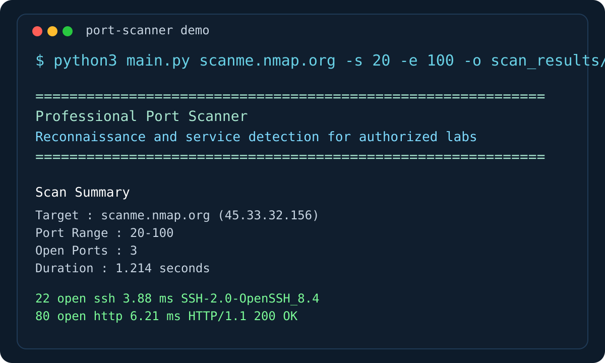
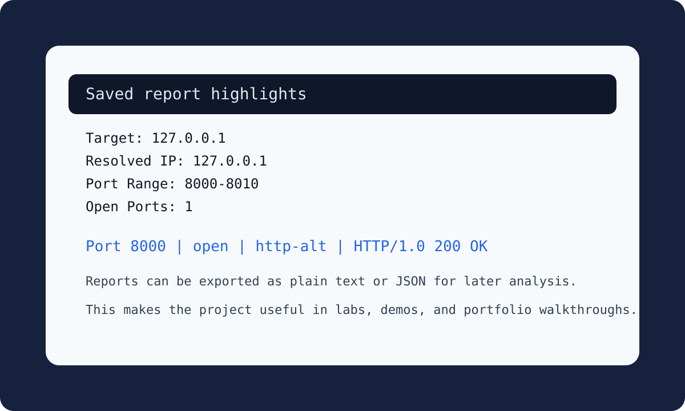

# Professional Python Port Scanner

A beginner-friendly but portfolio-ready TCP port scanner built for cybersecurity and penetration testing students. It uses Python socket programming, concurrent scanning, and lightweight banner grabbing to identify open ports and likely services on authorized targets.



## Ethical Disclaimer

This project is strictly for educational use and authorized security testing only. Do not scan systems, networks, or services unless you have explicit permission from the owner. Unauthorized scanning may violate laws, policies, and acceptable use agreements.

## Why This Project Matters

This project helps demonstrate:

- Networking fundamentals and TCP communication
- Python socket programming
- Reconnaissance basics and service discovery
- Multi-threading for security automation
- Clean project organization for GitHub portfolios

## Features

- Custom IP address or hostname input
- Configurable port range scanning
- Open TCP port detection
- Multi-threaded scanning for improved speed
- Basic banner grabbing and service identification
- Configurable timeout handling
- Defensive error handling
- Clean CLI output for easy reading
- Save results as `.txt` or `.json`
- Modular Python code that is easy to study and extend

## Project Structure

```text
professional-port-scanner/
├── LICENSE
├── README.md
├── main.py
├── requirements.txt
├── .gitignore
├── docs/
│   └── images/
│       ├── port-scanner-demo.svg
│       └── port-scanner-results.svg
├── port_scanner/
│   ├── __init__.py
│   ├── __main__.py
│   ├── cli.py
│   ├── models.py
│   ├── scanner.py
│   ├── utils.py
│   └── writer.py
└── tests/
    └── test_scanner.py
```

## Screenshots

### CLI Scan Output


### Saved Results View



## How It Works

1. The user supplies a target IP address or hostname.
2. The scanner resolves hostnames to an IPv4 address.
3. A thread pool scans each port in the selected range.
4. If a TCP connection succeeds, the port is marked as open.
5. The scanner attempts to identify the service and capture a banner.
6. Results are printed to the terminal and can optionally be saved to a file.

## Requirements

- macOS, Linux, or Windows
- Python 3.10 or newer
- Network access to an authorized target

This project uses only the Python standard library, so no third-party packages are required.

## Step-by-Step Setup on Mac

1. Open Terminal.
2. Move into the project folder:

   ```bash
   cd /path/to/professional-port-scanner
   ```

3. Confirm Python 3 is installed:

   ```bash
   python3 --version
   ```

4. Create a virtual environment:

   ```bash
   python3 -m venv .venv
   ```

5. Activate the virtual environment:

   ```bash
   source .venv/bin/activate
   ```

6. Install dependencies:

   ```bash
   pip install -r requirements.txt
   ```

## Step-by-Step Run Instructions

Run a basic scan against an authorized target:

```bash
python3 main.py 127.0.0.1 -s 1 -e 1024
```

Run a faster scan with custom timeout and worker count:

```bash
python3 main.py scanme.nmap.org -s 20 -e 200 -t 0.75 -w 150
```

Save results to a text report:

```bash
python3 main.py 127.0.0.1 -s 1 -e 1024 -o scan_results/local_report.txt
```

Save results to JSON:

```bash
python3 main.py 127.0.0.1 -s 1 -e 1024 -o scan_results/local_report.json
```

You can also run the package directly:

```bash
python3 -m port_scanner 127.0.0.1 -s 1 -e 1024
```

## Usage Reference

```bash
python3 main.py <target> [options]
```

### Arguments

- `target`: Target hostname or IPv4 address

### Options

- `-s, --start-port`: Starting port number
- `-e, --end-port`: Ending port number
- `-t, --timeout`: Socket timeout in seconds
- `-w, --workers`: Number of worker threads
- `-o, --output`: Output path for `.txt` or `.json` results
- `--banner-bytes`: Maximum banner size to capture
- `--version`: Show project version

## Example Output

```text
============================================================
  Professional Port Scanner
  Reconnaissance and service detection for authorized labs
============================================================

Scan Summary
Target       : 127.0.0.1 (127.0.0.1)
Port Range   : 20-100
Open Ports   : 1
Duration     : 0.143 seconds

Discovered Services
PORT    STATE     SERVICE           RESPONSE    BANNER
---------------------------------------------------------------
80      open      http              1.42 ms     HTTP/1.1 200 OK
```

## Running Tests

```bash
python3 -m unittest discover -s tests -v
```

## GitHub Upload Instructions

1. Create a new repository on GitHub.
2. In Terminal, move into this project folder.
3. Initialize Git:

   ```bash
   git init
   ```

4. Add the files:

   ```bash
   git add .
   ```

5. Create your first commit:

   ```bash
   git commit -m "Initial commit: professional Python port scanner"
   ```

6. Connect your GitHub repository:

   ```bash
   git remote add origin https://github.com/your-username/your-repo-name.git
   ```

7. Push the code:

   ```bash
   git branch -M main
   git push -u origin main
   ```

## Security and Deployment Notes

- Run this only in lab environments or on systems you own or are authorized to test.
- Some services do not return banners, so service detection is best-effort rather than guaranteed.
- High thread counts can cause noisy traffic or unstable results on slower systems.
- Firewalls, IDS, or rate limits can affect scan accuracy.
- Local execution is recommended; this project is not designed as an internet-facing deployed service.

## Suggested Future Upgrades

- UDP scanning support
- CIDR range and subnet scanning
- CSV export
- Nmap-style service fingerprinting
- OS detection experiments
- Progress bars and richer terminal dashboards
- Config file support
- Unit tests for additional probe types

## Portfolio Talking Points

If you showcase this project in a portfolio or interview, you can explain:

- How TCP connect scans work
- Why timeouts and threading matter in network tooling
- The limits of banner grabbing
- How modular code improves maintainability
- How security tools should include ethical safeguards and clear documentation
